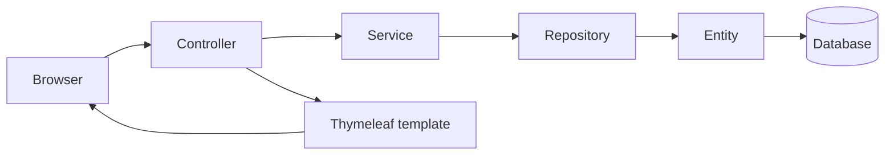

# CodeQuest — Project Map (What Each File Does)

**Purpose:** a orientation guide for the team. If you are lost, read this first.
It is not a design document; it answers “where do I edit X?”.

> ⚠️ **STATUS (November 15, 2026):** the codebase was stripped to the bare
> authentication backbone. **All Sprint 2 feature packages, templates and tests
> described in this map (studio/, classroom/, hints/, discussion/, profile/,
> assessment/, ScoreService, the dashboards) were REMOVED and are ⬜ PENDING
> rebuild in upcoming sprints.** This map is retained as the historical /
> planning reference for the rebuild — treat every feature path below as a
> *planned* location, not an existing one. Current reality: see root `README.md`.

---

## 1. The 30-Second Mental Model

The app is split into four kinds of files:

| Kind | Folder | Think of it as… |
|---|---|---|
| **Java behavior** | `src/main/java/com/codequest/` | What the app *does* (routes, rules, database access) |
| **HTML screens** | `src/main/resources/templates/` | What the user *sees* |
| **CSS / assets** | `src/main/resources/static/` | How the screens *look* |
| **Configuration** | `src/main/resources/*.properties`, `pom.xml` | How the app *starts* (database, server, dependencies) |

A request flows like this:

```text
Browser
  -> Controller   (receives the URL, picks the screen)
  -> Service      (business rules, permissions, calculations)
  -> Repository   (database queries)
  -> Entity       (the Java object mapped to a table)
  -> Database     (H2 in tests, MySQL in development)
  -> Thymeleaf template (builds the HTML)
  -> Browser
```

The same flow as a diagram:



---

## 2. Top-Level Folder Tree

```text
Project/
├── pom.xml                     Maven dependencies (Spring Boot, JPA, Security, Thymeleaf)
├── docker-compose.yml          Optional local MySQL container
├── .gitignore                  Files Git should ignore (target/, IDE files)
├── README.md                   Setup + how to run + feature quick checks
├── HANDOVER.md                 Progress log and resume-tomorrow checklist
├── PROJECT_STATUS.md           What is done vs missing from the 20-feature list
├── PROJECT_MAP.md              THIS FILE — where everything lives
├── spec.md                     Original project brief (20 features)
├── codequest_build_prompt.md    The build instructions used by the team
├── docs/
│   └── phase-0-design.md       Architecture, ER diagram, route table, wireframes
├── team/
│   ├── SPRINTS.md              Sprint 1/2 split + exact git commands
│   ├── hasin/                  F1 + F2 docs
│   ├── adnan/                  F3 docs
│   ├── tafika/                 F4 docs
│   └── tanvir/                 F5 docs
└── src/
    ├── main/
    │   ├── java/com/codequest/          Java code
    │   └── resources/                   Templates, CSS, config
    └── test/java/com/codequest/         Automated tests
```

`target/` is **generated by Maven** (compiled classes, test reports). Never edit it;
it is ignored by Git.

---

## 3. Java Packages — Who Does What

All Java code lives under `src/main/java/com/codequest/`.

| Package | Responsibility | Key files |
|---|---|---|
| `domain/` | JPA entities. One class = one database table. | `User`, `Level`, `Floor`, `Obstacle`, `Assessment`, `Attempt`, `Hint`, `HintUsage`, `Comment`, `LevelProgress`, `Classroom`, `ClassroomMember`, `Role` |
| `repository/` | Spring Data interfaces. You declare a method name and Spring writes the SQL. | `UserRepository`, `LevelRepository`, `AttemptRepository`, `LevelProgressRepository`, … |
| `assessment/` | Plug-in architecture for question types. | `AssessmentHandler`, `AssessmentService`, `CheckResult`, `JsonSupport`, `mcq/McqAssessmentHandler` |
| `common/` | Shared infrastructure used by every feature. | `config/SecurityConfig`, `security/*`, `seed/DemoDataSeeder`, `service/ScoreService`, `web/HomeController`, `web/GlobalExceptionHandler` |
| `studio/` | **F1**: teacher Creator Studio. | `StudioController`, `StudioService`, `form/*` |
| `classroom/` | **F2**: classes, join codes, roster. | `ClassroomController`, `ClassroomService`, `form/*` |
| `hints/` | **F3**: 3-level hints. | `HintController`, `HintService`, `form/HintForm`, `view/HintView` |
| `discussion/` | **F4**: per-castle comments. | `DiscussionController`, `DiscussionService` |
| `profile/` | **F5**: castle play, progress, profile. | `PlayController`, `PlayService`, `ProfileController`, `ProfileService`, `view/*` |

### Naming convention (very useful)

| Suffix | Meaning |
|---|---|
| `*Controller` | Maps URLs to pages/actions. Start here when a button does nothing. |
| `*Service` | Business rules, permissions, calculations. Start here for “why was I blocked?” |
| `*Repository` | Database queries only. |
| `*Form` | Data coming **in** from an HTML form (with validation). |
| `*View` | Data going **out** to an HTML template. |
| `*Test` | Automated test class. |

---

## 4. Templates — Which Folder Renders Which Page

All HTML lives under `src/main/resources/templates/`.

| Folder / file | Page or purpose | Controller |
|---|---|---|
| `fragments/layout.html` | Shared navbar, flash messages, footer, `<head>` | every page |
| `home/index.html` | Public landing page | `HomeController` |
| `auth/login.html`, `auth/register.html` | Login and signup | `HomeController` |
| `teacher/home.html` | Teacher dashboard | `HomeController` |
| `student/home.html` | Student dashboard | `HomeController` |
| `studio/*` | F1 teacher: castle list, castle form, castle design, floor design, question form | `StudioController` |
| `classroom/*` | F2: class list, create class, class detail/roster, join by code | `ClassroomController` |
| `hints/*` | F3: hint library, hint chamber, shared hint editor/panel | `HintController` |
| `discussion/*` | F4: all boards, one board, shared comment section/moderation | `DiscussionController` |
| `profile/play.html` | F5: castle climb (floors, monster, questions, hints, comments) | `PlayController` |
| `profile/top.html` | F5: summit after completion (full code) | `PlayController` |
| `profile/profile.html` | F5: completion %, streak, score table | `ProfileController` |
| `student/levels.html` | F5: “My Castles” list | `ProfileController` |
| `assessment/mcq-editor.html` | Teacher MCQ editor fragment | used by Studio |
| `assessment/mcq-play.html` | Student MCQ player fragment | used by Play |
| `error/403.html`, `404.html`, `500.html` | Friendly error pages | Spring / `GlobalExceptionHandler` |

`fragments/layout.html` is the most important template: change the navbar or footer
there once and every page updates.

---

## 5. “I Want to Change X — Which File?”

| I want to… | Edit this |
|---|---|
| Add/change a URL or redirect | the relevant `*Controller.java` |
| Change a business rule or permission check | the relevant `*Service.java` |
| Add/change a database field or table | `domain/*.java` (Hibernate updates the schema on restart) |
| Add a database query | `repository/*.java` |
| Change a page’s text/layout | the matching `.html` in `templates/` |
| Change the navbar or footer | `templates/fragments/layout.html` |
| Change colors, buttons, spacing | `static/css/app.css` |
| Change the score formula | `common/service/ScoreService.java` |
| Change who can access which URL | `common/config/SecurityConfig.java` |
| Change the demo teacher/student/castle data | `common/seed/DemoDataSeeder.java` |
| Change login/streak behavior | `common/security/LoginSuccessHandler.java` |
| Add a new question type (e.g. SCRAMBLE) | new handler in `assessment/`, plus `templates/assessment/<type>-editor.html` and `<type>-play.html` |
| Change a form field or validation | the matching `*Form.java` |
| Fix a test | the matching `*Tests.java` under `src/test/java` |
| Change database/H2 settings | `application.properties` (MySQL) or `application-test.properties` (H2) |

---

## 6. Feature Ownership Map

| Feature | Java package | Templates | Dedicated tests |
|---|---|---|---|
| **F1 Creator Studio** (spec #11) | `studio/` | `templates/studio/` | — (covered manually) |
| **F2 Classroom & Roles** (spec #2) | `classroom/` + `common/config/SecurityConfig` | `templates/classroom/` | — (covered manually) |
| **F3 3-Level Hints** (spec #15) | `hints/` | `templates/hints/` | `HintFeatureTests` (13) |
| **F4 Discussion Board** (spec #16) | `discussion/` | `templates/discussion/` | `DiscussionFeatureTests` (8) |
| **F5 Profile & Play** (spec #1) | `profile/` | `templates/profile/`, `templates/student/levels.html`, `templates/assessment/mcq-play.html` | `PlayFeatureTests` (14) |
| Backbone | `domain/`, `repository/`, `assessment/`, `common/` | `fragments/`, `home/`, `auth/`, `teacher/`, `student/home.html` | `CodeQuestApplicationTests` (2) |

---

## 7. Where the Database Comes From

You will not find `CREATE TABLE` SQL files. The tables are generated from the
entity classes in `domain/`:

- `@Entity` class -> one table
- field -> one column
- `@ManyToOne` -> a foreign-key column
- `spring.jpa.hibernate.ddl-auto=update` (in `application.properties`) keeps the
  schema in sync when you restart.

That is why changing a field in `domain/Level.java` changes the `levels` table.

---

## 8. Recommended Reading Order (about 30 minutes)

If you want to understand the whole app, read in this order:

1. `pom.xml` — what libraries exist.
2. `src/main/resources/application.properties` — database/server settings.
3. `domain/User.java`, `Level.java`, `Floor.java`, `Obstacle.java`, `Assessment.java`,
   `Attempt.java`, `LevelProgress.java` — the data model.
4. `repository/LevelRepository.java` — how queries are declared.
5. `common/config/SecurityConfig.java` — who can open which URL.
6. `common/web/HomeController.java` — login, register, dashboards.
7. `studio/StudioController.java` + `StudioService.java` — teacher creates content.
8. `profile/PlayController.java` + `PlayService.java` — student plays content.
9. `templates/fragments/layout.html` — the shared page shell.
10. `templates/profile/play.html` — the biggest page, ties F3/F4/F5 together.

---

## 9. Common Beginner Confusions

- **Controller vs Service:** the controller is a thin traffic cop; the service holds
  the real rules. If a page loads but the rule is wrong, look in the service.
- **Entity vs Repository:** the entity is the data; the repository is how you fetch it.
- **Form vs View:** forms bring data **in** from the browser; views carry data **out**
  to the template.
- **Template vs static:** `templates/` are dynamic Thymeleaf pages; `static/` holds
  files served as-is (CSS, images, JS).
- **`target/`:** generated output. Ignore it; never hand-edit it.
- **Port already in use:** stop the old app or run with
  `--server.port=8081`.

---

## 10. One Concrete Example: Student Submits an Answer

1. `templates/profile/play.html` renders the MCQ form with the assessment id.
2. Browser POSTs to `/play/{levelId}/assessments/{assessmentId}/submit`.
3. `PlayController.submit(...)` receives the form.
4. `PlayService.submitAttempt(...)` checks access, current floor and whether the
   question is already solved.
5. `AssessmentService.check(...)` -> `McqAssessmentHandler` compares the answer JSON.
6. `AttemptRepository.saveAndFlush(...)` stores the attempt.
7. `ScoreService` recalculates the score.
8. `PlayService` advances the floor if all questions are correct.
9. The controller redirects back to `/play/{levelId}`, which renders the next floor.
