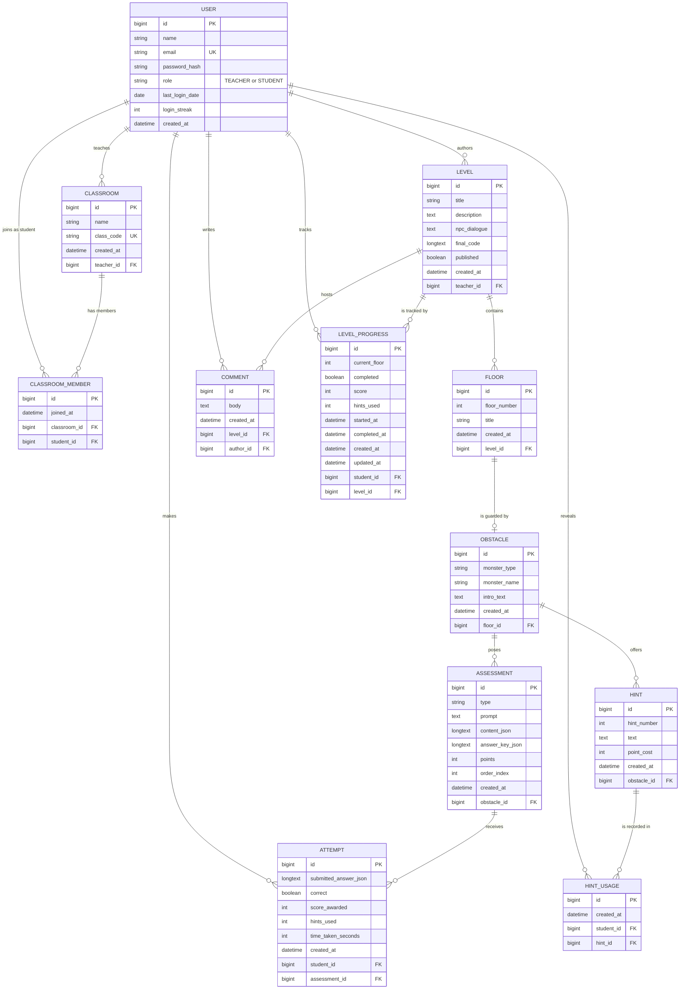

# CodeQuest — Phase 0 Design

**Status:** design only. No application code is written in this phase.
**Date:** 11 November 2026
**Deadline:** working demo on 17 November 2026

**Inputs read:**

- `CodeQuest_ The modern approach to learning coding.docx.pdf` — the full 20-feature project brief and the four-person task split.
- `Mock up_261105_143737 (1).pdf` — the core gameplay sketch: a castle with stacked floors, a monster/obstacle on each floor, coding questions to pass, an initial NPC who gives context, and the whole code revealed at the top. It also sketches future puzzle ideas (falling snippet, flow-connecting snippets, fill-in-the-blank, scrambles) and the teacher flow with two publish constraints.
- `codequest_build_prompt.md` — fixes the stack and narrows the build to five features: Creator Studio (F1), Classroom & Roles (F2), Three-Level Hints (F3), Discussion Board (F4), Profile & Progress + student play page (F5).

---

## 1. Architecture in plain English

CodeQuest is a server-rendered Spring Boot application. A browser request first passes through **Spring Security**, which checks the session and the user's role. It then reaches a **Controller**. Controllers stay thin: they read form data, call a service, and choose a view. The **Service** holds the real rules — ownership, publish validation, hint order, scoring. The service calls a Spring Data **Repository**, which turns a method name into SQL. Hibernate maps the result into an **Entity**, a plain Java class that mirrors a MySQL table. The service returns data to the controller, which puts it in the **Model**. **Thymeleaf** renders an HTML page from a template plus that model, and the HTML goes back to the browser.

Concrete example — *a teacher saves a floor*: the form POSTs to `/studio/levels/7/floors`. Security confirms `ROLE_TEACHER`. `StudioController` calls `StudioService`, which checks that level 7 belongs to this teacher and that the floor number is free. `FloorRepository.save()` issues an `INSERT`. MySQL stores the row. The controller redirects, reloads level 7 through `LevelRepository`, and Thymeleaf redraws the floor list.

*(173 words)*

---

## 2. Data model (ER diagram)

### Design choices worth calling out

1. **One generic `assessment` table, not one table per question type.** `type` is a string; `content` and `answer_key` are JSON text. Adding `SCRAMBLE` later needs no schema change. See section 6.
2. **Hints belong to the `Obstacle`, not the `Assessment`.** Every present and future assessment type therefore works with hints automatically.
3. **`Attempt` is append-only.** Every submission is stored. A wrong answer is data, not something to overwrite. Correctness is derived from prior attempts, so no extra "solved" table is needed.
4. **`Level.final_code` is added to the suggested entity list.** It is the whole code shown at the top of the castle, as drawn in the mockup. Without it, F5 cannot satisfy "final floor shows the full code".
5. **One obstacle per floor, many assessments per obstacle.** The sketch shows one monster per floor. A monster can ask more than one question; the monster is defeated when every assessment on it has been answered correctly.
6. **Visibility needs no join table.** A student's available levels are the published levels authored by teachers of the classrooms the student has joined. This is a query, not stored state.

### ER diagram



### Entity dictionary

| Entity | One-sentence purpose | Key constraints |
|---|---|---|
| `User` | An account, either a teacher or a student. Stored in table `users` to avoid reserved keyword conflicts. | `email` unique; `role` stored as a string; `@Table(name="users")`. |
| `Classroom` | A teacher-owned class that students join with a code. | `class_code` unique. |
| `ClassroomMember` | The join row between a classroom and a student. | Unique `(classroom_id, student_id)`. |
| `Level` | A castle authored by a teacher, including the NPC story and the final code. | `teacher_id` FK; only the owner may edit. |
| `Floor` | One ordered layer inside a castle. | Unique `(level_id, floor_number)`. Modification restricted to draft levels without progress. |
| `Obstacle` | The monster guarding one floor. | Unique `floor_id` (one obstacle per floor). |
| `Assessment` | One challenge the monster poses, stored generically. | `type` string; JSON `content` and `answer_key`. |
| `Attempt` | One immutable record of one answer submission. | Never updated; many per student/assessment. |
| `Hint` | One of up to three ordered hints for an obstacle. | Unique `(obstacle_id, hint_number)`; `point_cost >= 0`. |
| `HintUsage` | Proof that a student revealed a hint, so its cost is charged once. | Unique `(student_id, hint_id)`. |
| `Comment` | A discussion post attached to a level. Stored in table `comments` with text column named `body`. | `author_id`, `level_id` FKs; `@Table(name="comments")`, column `body`. |
| `LevelProgress` | The student's state in one castle: current floor, score, completion. | Unique `(student_id, level_id)`. |

**Referential rules:** all foreign keys use `ON DELETE CASCADE` where the child cannot exist alone (floor → level, obstacle → floor, assessment → obstacle, hint → obstacle, member → classroom, comment → level). `Attempt` and `HintUsage` are deliberately kept even if a student leaves a class, because they are learning records. Deleting a `Level` is restricted once it has attempts; the studio will archive/unpublish instead. This is a safety rule, not extra UI.

**JSON contract examples:**

- MCQ content: `{"options":["GET handler","Service","Repository","Template"]}`
- MCQ answer key: `{"correct":1}` — **server-side only, never placed in the student model or HTML**
- Future SCRAMBLE content: `{"lines":["x = 1","print(x)"]}`
- Future SCRAMBLE answer key: `{"order":[1,0]}`

---

## 3. UML class diagram

```mermaid
classDiagram
    direction TB

    namespace domain {
        class Role {
            <<enumeration>>
            TEACHER
            STUDENT
        }

        class User {
            -Long id
            -String name
            -String email
            -String passwordHash
            -Role role
            -LocalDate lastLoginDate
            -int loginStreak
            -LocalDateTime createdAt
        }

        class Classroom {
            -Long id
            -String name
            -String classCode
            -User teacher
            -LocalDateTime createdAt
        }

        class ClassroomMember {
            -Long id
            -Classroom classroom
            -User student
            -LocalDateTime joinedAt
        }

        class Level {
            -Long id
            -String title
            -String description
            -String npcDialogue
            -String finalCode
            -boolean published
            -User teacher
            -LocalDateTime createdAt
        }

        class Floor {
            -Long id
            -Level level
            -int floorNumber
            -String title
            -LocalDateTime createdAt
        }

        class Obstacle {
            -Long id
            -Floor floor
            -String monsterType
            -String monsterName
            -String introText
            -LocalDateTime createdAt
        }

        class Assessment {
            -Long id
            -Obstacle obstacle
            -String type
            -String prompt
            -String content
            -String answerKey
            -int points
            -int orderIndex
            -LocalDateTime createdAt
        }

        class Attempt {
            -Long id
            -User student
            -Assessment assessment
            -String submittedAnswer
            -boolean correct
            -int scoreAwarded
            -int hintsUsed
            -int timeTakenSeconds
            -LocalDateTime createdAt
        }

        class Hint {
            -Long id
            -Obstacle obstacle
            -int hintNumber
            -String text
            -int pointCost
            -LocalDateTime createdAt
        }

        class HintUsage {
            -Long id
            -User student
            -Hint hint
            -LocalDateTime createdAt
        }

        class Comment {
            -Long id
            -Level level
            -User author
            -String body
            -LocalDateTime createdAt
        }

        class LevelProgress {
            -Long id
            -User student
            -Level level
            -int currentFloor
            -boolean completed
            -int score
            -int hintsUsed
            -LocalDateTime startedAt
            -LocalDateTime completedAt
            -LocalDateTime createdAt
            -LocalDateTime updatedAt
        }
    }

    namespace repository {
        class UserRepository
        class ClassroomRepository
        class ClassroomMemberRepository
        class LevelRepository
        class FloorRepository
        class ObstacleRepository
        class AssessmentRepository
        class AttemptRepository
        class HintRepository
        class HintUsageRepository
        class CommentRepository
        class LevelProgressRepository
    }

    namespace assessment {
        class AssessmentHandler {
            <<interface>>
            +getType() String
            +validateDefinition(String contentJson, String answerKeyJson) void
            +check(Assessment assessment, String submittedAnswerJson) CheckResult
        }

        class CheckResult {
            -boolean correct
            -int scoreAwarded
            -String feedback
        }

        class AssessmentService {
            -Map handlers
            +types() List
            +get(String type) AssessmentHandler
            +validate(Assessment assessment) void
            +check(Assessment assessment, String answerJson) CheckResult
        }

        class McqAssessmentHandler {
            +getType() String
            +validateDefinition(String contentJson, String answerKeyJson) void
            +check(Assessment assessment, String submittedAnswerJson) CheckResult
        }
    }

    namespace feature {
        class SecurityConfig
        class LoginSuccessHandler
        class HomeController
        class StudioController
        class StudioService
        class ClassroomController
        class ClassroomService
        class PlayController
        class PlayService
        class HintController
        class HintService
        class DiscussionController
        class DiscussionService
        class ProfileController
        class ProfileService
        class DataSeeder
    }

    Classroom --> User : teacher
    ClassroomMember --> Classroom
    ClassroomMember --> User : student
    Level --> User : teacher
    Floor --> Level
    Obstacle --> Floor
    Assessment --> Obstacle
    Attempt --> User : student
    Attempt --> Assessment
    Hint --> Obstacle
    HintUsage --> User : student
    HintUsage --> Hint
    Comment --> Level
    Comment --> User : author
    LevelProgress --> User : student
    LevelProgress --> Level
    User --> Role

    StudioController --> StudioService
    StudioService --> LevelRepository
    StudioService --> FloorRepository
    StudioService --> ObstacleRepository
    StudioService --> AssessmentRepository
    StudioService --> HintRepository
    StudioService --> AssessmentService

    ClassroomController --> ClassroomService
    ClassroomService --> ClassroomRepository
    ClassroomService --> ClassroomMemberRepository
    ClassroomService --> UserRepository

    PlayController --> PlayService
    PlayService --> LevelRepository
    PlayService --> LevelProgressRepository
    PlayService --> AttemptRepository
    PlayService --> HintUsageRepository
    PlayService --> AssessmentService

    HintController --> HintService
    HintService --> HintRepository
    HintService --> HintUsageRepository
    HintService --> LevelProgressRepository

    DiscussionController --> DiscussionService
    DiscussionService --> CommentRepository
    DiscussionService --> LevelRepository

    ProfileController --> ProfileService
    ProfileService --> LevelProgressRepository
    ProfileService --> AttemptRepository
    ProfileService --> LevelRepository

    LoginSuccessHandler --> UserRepository
    DataSeeder --> UserRepository
    DataSeeder --> ClassroomRepository
    DataSeeder --> LevelRepository

    AssessmentService o-- AssessmentHandler
    AssessmentHandler <|.. McqAssessmentHandler
    AssessmentService ..> CheckResult
    StudioService ..> CheckResult
    PlayService ..> CheckResult

    UserRepository ..> User
    ClassroomRepository ..> Classroom
    ClassroomMemberRepository ..> ClassroomMember
    LevelRepository ..> Level
    FloorRepository ..> Floor
    ObstacleRepository ..> Obstacle
    AssessmentRepository ..> Assessment
    AttemptRepository ..> Attempt
    HintRepository ..> Hint
    HintUsageRepository ..> HintUsage
    CommentRepository ..> Comment
    LevelProgressRepository ..> LevelProgress
```



### How the layers depend

- **Controllers never touch repositories.** They call one feature service.
- **Feature services own the rules** and are the only classes that call repositories.
- **`AssessmentService` is the plug-in registry.** `StudioService` validates definitions through it; `PlayService` checks submissions through it. No `if (type.equals(...))` anywhere.
- **`PlayService` is the only place that advances a floor.** It re-checks all assessments on the obstacle, so a student cannot skip ahead by editing a URL.
- **Security** is centralised in `SecurityConfig`; ownership is re-checked in services, because URL rules alone cannot protect `/studio/levels/7` from another teacher.

---

## 4. Folder structure and URL routes

### Package-by-feature structure

```text
codequest/
├── pom.xml
├── README.md
├── .gitignore
├── docs/
│   └── phase-0-design.md
└── src/
    ├── main/
    │   ├── java/com/codequest/
    │   │   ├── CodeQuestApplication.java
    │   │   │
    │   │   ├── domain/                      ← shared entities (Phase 1, backbone)
    │   │   │   ├── User.java
    │   │   │   ├── Role.java
    │   │   │   ├── Classroom.java
    │   │   │   ├── ClassroomMember.java
    │   │   │   ├── Level.java
    │   │   │   ├── Floor.java
    │   │   │   ├── Obstacle.java
    │   │   │   ├── Assessment.java
    │   │   │   ├── Attempt.java
    │   │   │   ├── Hint.java
    │   │   │   ├── HintUsage.java
    │   │   │   ├── Comment.java
    │   │   │   └── LevelProgress.java
    │   │   │
    │   │   ├── repository/                  ← shared Spring Data interfaces (Phase 1)
    │   │   │   ├── UserRepository.java
    │   │   │   ├── ClassroomRepository.java
    │   │   │   ├── ClassroomMemberRepository.java
    │   │   │   ├── LevelRepository.java
    │   │   │   ├── FloorRepository.java
    │   │   │   ├── ObstacleRepository.java
    │   │   │   ├── AssessmentRepository.java
    │   │   │   ├── AttemptRepository.java
    │   │   │   ├── HintRepository.java
    │   │   │   ├── HintUsageRepository.java
    │   │   │   ├── CommentRepository.java
    │   │   │   └── LevelProgressRepository.java
    │   │   │
    │   │   ├── common/                      ← backbone-owned shared code
    │   │   │   ├── config/SecurityConfig.java
    │   │   │   ├── security/CodeQuestUserDetailsService.java
    │   │   │   ├── security/LoginSuccessHandler.java
    │   │   │   ├── service/ScoreService.java
    │   │   │   ├── web/HomeController.java
    │   │   │   ├── web/GlobalExceptionHandler.java
    │   │   │   └── seed/DemoDataSeeder.java
    │   │   │
    │   │   ├── assessment/                  ← shared plug-in infrastructure
    │   │   │   ├── AssessmentHandler.java
    │   │   │   ├── CheckResult.java
    │   │   │   ├── AssessmentService.java
    │   │   │   ├── JsonSupport.java
    │   │   │   └── mcq/McqAssessmentHandler.java
    │   │   │
    │   │   ├── studio/                      ← F1 (Hasin)
    │   │   │   ├── StudioController.java
    │   │   │   ├── StudioService.java
    │   │   │   └── form/LevelForm.java, FloorForm.java, ObstacleForm.java,
    │   │   │            AssessmentForm.java, HintForm.java
    │   │   │
    │   │   ├── classroom/                   ← F2 (Hasin, shared with backbone)
    │   │   │   ├── ClassroomController.java
    │   │   │   ├── ClassroomService.java
    │   │   │   └── form/ClassroomForm.java, JoinClassForm.java
    │   │   │
    │   │   ├── hints/                       ← F3 (Adnan)
    │   │   │   ├── HintController.java
    │   │   │   ├── HintService.java
    │   │   │   └── HintView.java
    │   │   │
    │   │   ├── discussion/                  ← F4 (Tafika)
    │   │   │   ├── DiscussionController.java
    │   │   │   ├── DiscussionService.java
    │   │   │   └── form/CommentForm.java
    │   │   │
    │   │   └── profile/                     ← F5 (Tanvir) + student play page
    │   │       ├── ProfileController.java
    │   │       ├── ProfileService.java
    │   │       ├── PlayController.java
    │   │       ├── PlayService.java
    │   │       └── view/PlayView.java, ProfileView.java
    │   │
    │   └── resources/
    │       ├── application.properties
    │       ├── static/css/app.css
    │       ├── static/js/play.js
    │       └── templates/
    │           ├── fragments/layout.html    ← navbar, head, footer, flash messages
    │           ├── home/index.html
    │           ├── auth/login.html
    │           ├── auth/register.html
    │           ├── teacher/home.html
    │           ├── student/home.html
    │           ├── studio/level-list.html
    │           ├── studio/level-form.html
    │           ├── studio/level-design.html
    │           ├── studio/floor-design.html
    │           ├── studio/assessment-form.html
    │           ├── classroom/list.html
    │           ├── classroom/detail.html
    │           ├── classroom/join.html
    │           ├── profile/play.html
    │           ├── profile/top.html
    │           ├── profile/profile.html
    │           ├── assessment/mcq-editor.html
    │           ├── assessment/mcq-play.html
    │           └── error/403.html, error/404.html
    └── test/java/com/codequest/            ← a few handler/service unit tests
```

**Why `domain` and `repository` are not inside a feature package:** every feature reads shared data, and the prompt explicitly says to keep shared entities in `com.codequest.domain`. Keeping the repositories beside them prevents five people creating duplicate repositories. Everything else is package-by-feature, and each feature owns its own templates.

### Route table

Legend: **PUBLIC** = no login; **T** = `ROLE_TEACHER`; **S** = `ROLE_STUDENT`; **T/S** = logged in, plus a service-level ownership/membership check.

| Method | Path | Access | What it does |
|---|---|---|---|
| GET | `/` | PUBLIC | Landing page; if logged in, redirect to the correct home. |
| GET | `/login` | PUBLIC | Login form. |
| POST | `/login` | PUBLIC | Spring Security form login; BCrypt check. |
| GET | `/register` | PUBLIC | Registration form. |
| POST | `/register` | PUBLIC | Create account; BCrypt hash; role TEACHER or STUDENT. |
| POST | `/logout` | T/S | Log out (CSRF-protected form). |
| GET | `/teacher/home` | T | Teacher dashboard cards. |
| GET | `/student/home` | S | Student dashboard cards. |
| GET | `/studio/levels` | T | List only my castles. |
| GET | `/studio/levels/new` | T | New castle form. |
| POST | `/studio/levels` | T | Create a draft castle. |
| GET | `/studio/levels/{levelId}` | T (owner) | Level design page: floors, publish, discussion moderation. |
| GET | `/studio/levels/{levelId}/edit` | T (owner) | Edit title, description, NPC dialogue, final code. |
| POST | `/studio/levels/{levelId}` | T (owner) | Save level details. |
| POST | `/studio/levels/{levelId}/delete` | T (owner) | Delete a draft, or unpublish/archive if attempts exist. |
| POST | `/studio/levels/{levelId}/publish` | T (owner) | Validate constraints and publish. |
| POST | `/studio/levels/{levelId}/unpublish` | T (owner) | Return to draft; students can no longer start it. |
| POST | `/studio/levels/{levelId}/floors` | T (owner) | Add the next floor. |
| GET | `/studio/floors/{floorId}` | T (owner) | Floor design page: monster, assessments, hints. |
| POST | `/studio/floors/{floorId}` | T (owner) | Save floor title. |
| POST | `/studio/floors/{floorId}/delete` | T (owner) | Delete floor and renumber remaining floors. |
| POST | `/studio/floors/{floorId}/move-up` | T (owner) | Reorder floor up. |
| POST | `/studio/floors/{floorId}/move-down` | T (owner) | Reorder floor down. |
| POST | `/studio/floors/{floorId}/obstacle` | T (owner) | Create/update the monster on this floor. |
| POST | `/studio/floors/{floorId}/obstacle/delete` | T (owner) | Remove the monster. |
| GET | `/studio/obstacles/{obstacleId}/assessments/new` | T (owner) | Choose a type and open its editor. |
| POST | `/studio/obstacles/{obstacleId}/assessments` | T (owner) | Save a new assessment via its handler's validation. |
| GET | `/studio/assessments/{assessmentId}/edit` | T (owner) | Edit an assessment. |
| POST | `/studio/assessments/{assessmentId}` | T (owner) | Update an assessment via its handler. |
| POST | `/studio/assessments/{assessmentId}/delete` | T (owner) | Delete an assessment. |
| POST | `/studio/obstacles/{obstacleId}/hints` | T (owner) | Save/update the three hints and point costs. |
| GET | `/classroom` | T | My classrooms. |
| GET | `/classroom/new` | T | Create-class form. |
| POST | `/classroom` | T | Create class and generate a unique code. |
| GET | `/classroom/{classroomId}` | T (owner) | Class roster and code. |
| GET | `/classroom/join` | S | Join-class form. |
| POST | `/classroom/join` | S | Join by code (idempotent, friendly error if unknown). |
| GET | `/student/levels` | S | Published castles available through my classes. |
| GET | `/student/profile` | S | Completion %, streak, per-level progress. |
| GET | `/play/{levelId}` | S (member) | Play the castle at the saved current floor. |
| POST | `/play/{levelId}/assessments/{assessmentId}/answer` | S (member) | Check one answer server-side; save an `Attempt`. |
| POST | `/play/{levelId}/hints/{hintId}` | S (member) | Reveal the next hint in order; save `HintUsage`. |
| GET | `/play/{levelId}/top` | S (member, completed) | Top of the castle: full code + discussion. |
| POST | `/levels/{levelId}/comments` | T/S (access) | Add a comment; students must be in a class that can see the level; teachers must own it. |
| POST | `/comments/{commentId}/delete` | T (owner of level) | Delete a comment. |
| GET | `/css/**`, `/js/**` | PUBLIC | Static assets. |
| GET | `/error` | PUBLIC | Friendly error page. |

### Security rules

- `BCryptPasswordEncoder`, form login, CSRF enabled; every form uses `th:action`.
- URL rules (ordered specific before general):
  1. `/login`, `/register`, `/css/**`, `/js/**`, `/error`, `/` → `permitAll`
  2. `/classroom/join` → `hasRole('STUDENT')` (specific rule before `/classroom/**`)
  3. `/classroom/**`, `/studio/**`, `/teacher/**` → `hasRole('TEACHER')`
  4. `/student/**`, `/play/**` → `hasRole('STUDENT')`
  5. Any other request → `authenticated`
- Service-level checks are mandatory: `StudioService` always scopes by `teacherId`; `PlayService` always checks classroom membership; `DiscussionService` checks level access.
- Answer keys never leave the server. The play controller passes only parsed `content` (options/lines/template) into the model.
- Teachers and students cannot use each other's home pages; a logged-in user hitting the wrong home is redirected.

---

## 5. Page wireframes (text)

### A. Landing / login
Centered card on a dark "castle night" background. Logo and tagline at top ("Climb the castle. Learn the code."). Email + password fields, "Log in" button, link to "Create an account". Small demo-credentials box (teacher and student) for the demo. Error message area above the form.

### B. Register
Same card. Name, email, password, confirm password, role selector (Student / Teacher), "Create account", link back to login. Inline validation messages under each field. Side note: "Teacher accounts can create castles."

### C. Teacher home
Top navbar (CodeQuest, My Castles, Classrooms, log out). Hero strip: "Creator Studio". Grid of cards:
1. **My Castles (F1)** — count, link to `/studio/levels`.
2. **My Classrooms (F2)** — count, link to `/classroom`.
3. **Hints (F3)** — "Edit hints inside any floor".
4. **Discussion (F4)** — "Moderate comments from a castle's design page".
5. **Student Progress (F5)** — "Open the student view to see what learners see" (link to a demo student profile or a placeholder in Phase 1).
Each card has a short description and one button.

### D. Student home
Navbar (CodeQuest, My Castles, Profile, Join a class, log out). Hero: "Your next castle awaits". Cards: **Continue playing** (most recent incomplete castle), **My Castles (F5)**, **My Profile (F5)**, **Join a class (F2)**. If no class yet, a friendly empty state explains that a teacher code is needed.

### E. Studio: level list
Heading "My Castles" + "New castle" button. Table/cards: title, description snippet, floor count, status pill (Draft/Published), last updated, actions (Design, Edit, Delete). Empty state: "Build your first castle".

### F. Studio: level design
Two-column layout on desktop, stacked on mobile.
- **Left/main:** castle header with title, status, Publish/Unpublish button. A stacked floor list rendered bottom-to-top like a tower: each row shows floor number, title, monster emoji + name, "N assessments", "3 hints", and buttons (Floor design, Up, Down, Delete). "Add floor" form at the bottom.
- **Right/sidebar:** Level details form (title, description, NPC dialogue, final code). Publish checklist showing green/red ticks: at least one floor; every floor has a monster; every obstacle has at least one assessment; every assessment passes its handler validation.
- **Below:** discussion moderation panel (comments, delete buttons).
Friendly inline error banners instead of stack traces.

### G. Studio: floor design
Header with breadcrumb (My Castles / Castle / Floor 2) and "Back to castle". 
- **Monster card:** four large selectable monster tiles (Goblin 👺, Skeleton 💀, Slime 🟢, Dragon 🐉), monster name, intro text, Save/Remove.
- **Assessments card:** ordered list with type badge, prompt, points; Add assessment button; edit/delete per row. The type dropdown is built from `AssessmentService.types()`, so new types appear with no template edit.
- **Hints card:** three numbered rows, each with textarea + point-cost number input; explanatory labels "1 Nudge", "2 Concept Reminder", "3 Near-Solution". Save hints. Validation: no gaps; costs ≥ 0.

### H. Studio: assessment editor
Heading "Add a MCQ assessment". Prompt textarea. Type-specific fragment from the handler: for MCQ, four option inputs and a radio button marking the correct one. Points and order index. Save/Cancel. Errors are shown on the same page in a red box; the old values stay in the form.

### I. Classroom list (teacher)
Heading "My Classrooms" + "Create class". Cards or table: class name, large monospace join code, member count, created date, "Open roster". Copy-code button (small JS).

### J. Classroom detail (teacher)
Header: class name, join code, "Copy code". Roster table: student name, email, joined date. Empty state: "Share the code to invite students." Also a compact list of this teacher's published castles (so they can tell students what to play).

### K. Join class (student)
Centered card: "Enter your class code", one uppercase text input, Join button, link back. Shows success ("You joined CS101") or a friendly error ("No class uses that code").

### L. Student: my castles
Grid of castle cards: title, teacher name, floor count, progress bar, status (Not started / Floor 2 of 3 / Completed), score. Primary button Enter/Continue/Review. Empty state if no classes or no published castles.

### M. Play page (the core screen)
Top bar: castle title, floor counter (e.g. "Floor 2 of 3"), score, "Back to my castles".
Left sidebar: a vertical castle ladder with one rung per floor; completed rungs lit, current rung pulsing, locked rungs grey.
Main column:
1. **NPC dialogue card** on first entry: portrait circle, NPC name, the teacher-written context, "Begin the climb" button. After first visit it collapses into a "Story" link.
2. **Monster card:** emoji, monster name, intro text, "blocks the stairs" copy.
3. **Assessment card:** prompt, then the type-specific play fragment (MCQ radio options), Submit answer button. Feedback banner after submit: green "Correct — the monster falls back!" or amber "Not quite. Try again." Server response is a redirect + flash.
4. **Hints panel:** three slots. Revealed hints show text and "−10 pts" tag. Only the next hint has an active button; previous costs are listed. Confirm dialog before spending points.
5. **Discussion section:** list of comments (author, relative time, text), add-comment textarea, teacher-only delete buttons when the teacher moderates from the studio page.
On correct completion of the final floor, redirect to the top page.

### N. Top of the castle
Celebration header: "You conquered <castle>!" with score, hints used, completion date. A full-width code block showing the teacher's `finalCode`, line-numbered. Buttons: "Back to my castles", "View profile". Discussion section remains available.

### O. Student profile
Stat cards across the top: **Completion %** (completed castles / available castles), **Login streak** (days, flame emoji), **Total score**, **Castles completed**. Below: a table of every available castle with status, current floor, score, hints used, completed date, and a Continue/Review link. No charts in this scope.

### P. Error pages
Friendly 403 ("This area belongs to a different role"), 404 ("That page wandered off"), 500 ("Something broke; try again"). Always a link home. No stack traces in the browser.

---

## 6. Extensibility self-review (mandatory)

Question: *If we later add (a) badges, (b) a teacher class monitor, (c) a new puzzle type such as scrambled code lines, (d) diagnostic charts, and (e) a feedback/star-rating popup, which existing tables and classes would have to change?*

| Future addition | New tables | Existing tables changed | Existing classes changed | Honest verdict |
|---|---|---|---|---|
| **(a) Badges** | `badge` (definition), `student_badge` (award record) — or compute awards on read from `Attempt` / `LevelProgress` and store only when first seen | None | None in `domain`, repositories or services. A new `BadgeService` reads existing attempts. The profile **template** needs one include, and `ProfileController` needs one model attribute; that is a UI touch, not a schema/domain change. | Schema-safe. Only new tables/classes, plus one template include. |
| **(b) Teacher class monitor** | None | None | New `MonitorController`, `MonitorService`, `MonitorView` and a template. All data already exists: `ClassroomMember`, `LevelProgress`, `Attempt`, `User.lastLoginDate`. The teacher home gets one link (template only). | Only new classes. |
| **(c) New puzzle type, e.g. SCRAMBLE** | None | None — `assessment.type` is a string and content/answer are JSON | None. Add `ScrambleAssessmentHandler` (`@Component`) plus `scramble-editor.html` and `scramble-play.html`. The type dropdown is generated from `AssessmentService.types()`, so it appears automatically. | Only new classes/files. This is why the plug-in design exists. |
| **(d) Diagnostic charts** | None | None — `Attempt` already stores `correct`, `scoreAwarded`, `hintsUsed`, `timeTakenSeconds`, `createdAt` | New `DiagnosticsService` queries/aggregations, new controller and template with chart JS. Existing profile/teacher page gets an include. | Only new classes; schema unchanged. |
| **(e) Feedback / star rating** | `level_feedback` (level, student, stars 1–5, difficulty, comment, created_at) | None | New entity/repository/service/controller/template. The top-of-castle page gets a button/include. `LevelProgress` is untouched. | Only new tables/classes, plus one template include. |

**Conclusion:** the data model is additive for all five. No future feature requires altering an existing table, breaking an existing entity, or editing an `if/else` over assessment types. The only unavoidable touch points are **presentation**: adding a link or fragment include to an existing template, and sometimes adding one model attribute in a controller. That is not a table/class change and is normal for any UI. If the team insists on literally zero edits to existing templates, we could add a generic "page section provider" registry in Phase 1, but that is an extra abstraction this six-day beginner project does not need. I recommend the simple include.

**One intentional limitation to be honest about:** if a teacher edits or deletes an assessment after students have attempts, old attempts refer to the changed definition. The demo does not version assessments. Mitigation: block deleting an assessment that has attempts, and show a warning when editing. This is a small service check, not a schema change.

---

## 7. Assumptions

1. **Database:** MySQL 8 locally, database name `codequest`, schema generated by `spring.jpa.hibernate.ddl-auto=update`. Credentials live in `application.properties` as placeholders, overridable by environment variables. No secrets committed.
2. **Sample castle language:** the seed teaches a small **Java/Spring MVC** flow (`Controller → Service → Repository → Template`) because that is the course stack. The Python example in the mockup is treated as an illustration of AI line-by-line breakdown, not as the seed language.
3. **One monster per floor**, multiple assessments per monster; a monster is defeated only when all its assessments have a correct attempt. Hints attach to the monster.
4. **Unlimited retries.** Wrong answers are saved but never lock the student out. There are no timers in this scope.
5. **Score formula:** `max(0, sum of points from distinct correct assessments in the level − sum of point costs of distinct hints revealed in the level)`. Centralized in one class: `ScoreService` in `com.codequest.common.service` used by both play and hint flows. Recalculating is safer than incremental arithmetic and prevents double-charging.
6. **Floor modification and reordering safety:** Floor add, delete, and reordering are strictly allowed only while the level is a draft (`published == false`) AND has no `LevelProgress` records. Reordering swaps floor numbers using a temporary negative `floor_number` (e.g. `-1`) during an explicit transaction so the database constraint `UNIQUE (level_id, floor_number)` is never violated during in-place swaps.
7. **Hints are optional per obstacle**, but if hint 3 exists, hints 1 and 2 must exist. Point costs are integers ≥ 0. Hints can only be revealed 1 → 2 → 3.
8. **Publishing rules:** at least one floor; every floor has a monster; every monster has at least one valid assessment. The last rule is stricter than the sketch's two constraints and is necessary: a monster with no question would be an unwinnable castle.
9. **Visibility:** a student may join more than one classroom; they see the union of published castles authored by the teachers of those classrooms. A castle is invisible until published.
10. **Teacher registration code:** Teacher registration is protected by `app.teacher-code` (configurable in `application.properties`, default: `TEACH-2026`). Registering as a TEACHER requires this code; student registration requires none.
11. **Discussion placement:** the comment section appears on the student play page and on the teacher's level design page. Teachers moderate from the studio; no separate discussion page.
12. **Progress creation:** a `LevelProgress` row is created lazily on the first entry to a castle. Before that, the castle shows "Not started".
13. **CSRF stays on**, passwords are BCrypt, answer keys never reach the browser, and every ownership rule is checked again in a service.
14. **Seed is idempotent:** a `CommandLineRunner` inserts only when `userRepository.count() == 0`. It creates one teacher, one student, one class, and one published 3-floor castle teaching Java/Spring MVC flow with a monster, an MCQ, and three hints per floor.
15. **Out of scope by instruction:** 2D map/WASD, live coding battles, real-time chat, AI explainer, drag-and-drop sandbox, timers, charts, badges, star ratings, admin role, assessment versioning.

---

## 8. Answers to Clarifying Questions

1. **Seed content language:** Java/Spring MVC flow (`Controller → Service → Repository → Template`) is used for the sample castle.
2. **Database setup:** MySQL 8 is default for deployment/dev; an optional `docker-compose.yml` is provided alongside a lightweight H2 in-memory test profile (`application-test.properties`).
3. **Phase gates:** Strict stop after Phase 1 to let teammates work on their respective vertical slices in Phase 2 independently.

---

## 9. What Phase 1 will contain (next, only after "continue")

- `pom.xml` with Java 17, Spring Boot 3.x, web, Thymeleaf, data-jpa, security, validation, MySQL driver, Thymeleaf security extras. No Lombok (explicit getters/setters are easier for beginners to read).
- `application.properties` with commented DB settings and `ddl-auto=update`.
- All 12 entities and 12 repositories from section 2.
- The `com.codequest.assessment` plug-in infrastructure and the working MCQ handler + two fragments.
- Spring Security: register, login, logout, BCrypt, roles, role-based redirect, protected routes.
- Shared Thymeleaf layout, CSS, navbar/footer, flash messages.
- Teacher and student home pages with placeholder cards for F1–F5.
- Idempotent `DemoDataSeeder`.
- `README.md` with exact install/run steps and the top-five likely errors.

No feature logic (no studio CRUD, no hint reveal, no comments, no play loop) until Phase 2.

---

## What you just learned (Phase 0)

- A Spring request always flows **browser → security → controller → service → repository → entity → database**, and back out through a Thymeleaf template.
- A **thin controller** only moves data; the **service** is where rules like "this teacher owns this castle" belong.
- A foreign key is a column that points at another table's primary key; the ER diagram's crow's feet show one-to-many relationships.
- **Package-by-feature** keeps each teammate in their own folder, which is how four people avoid merge conflicts.
- Designing one generic `assessment` table with a `type` string means new puzzle types are new classes, not a database migration.

## Glossary

| Term | Plain meaning |
|---|---|
| **Controller** | The class that receives an HTTP request and chooses what to show. |
| **Service** | The class that holds business rules and coordinates repositories. |
| **Repository** | A Spring Data interface that generates database queries from method names. |
| **Entity** | A Java class mapped to a database table by Hibernate/JPA. |
| **Bean** | An object that Spring creates and manages for you. |
| **Dependency Injection** | Spring passes the objects a class needs through its constructor, instead of the class creating them with `new`. |
| **Model** | The box of data a controller hands to a template. |
| **Thymeleaf fragment** | A reusable piece of HTML (navbar, card, editor) included in other templates. |
| **`ddl-auto`** | A Hibernate setting; `update` adds missing tables/columns automatically. |
| **BCrypt** | A one-way password hash; the database never stores the real password. |
| **CSRF** | A protection token that stops another site from submitting forms as the logged-in user. |
